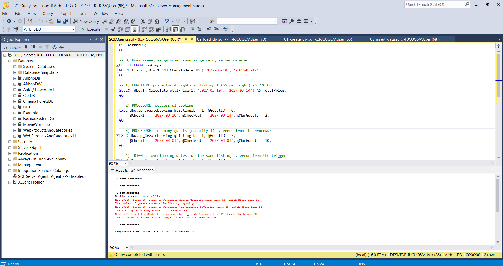
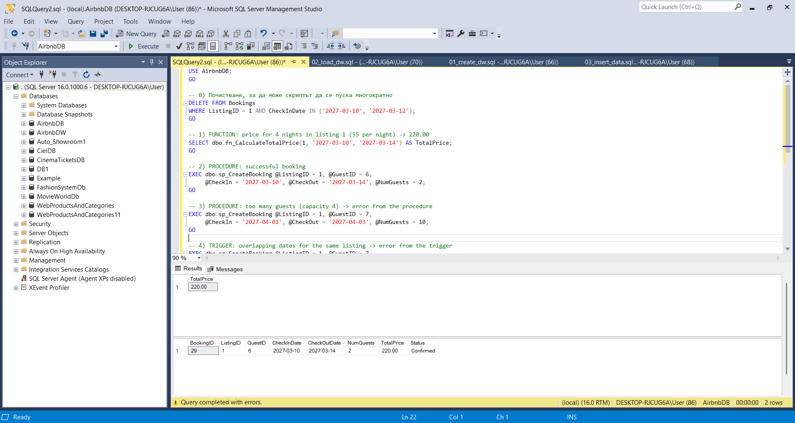
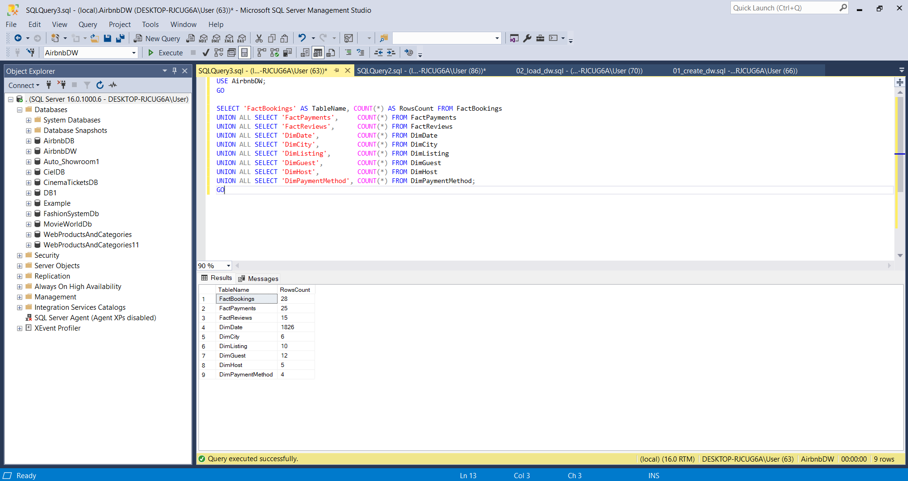
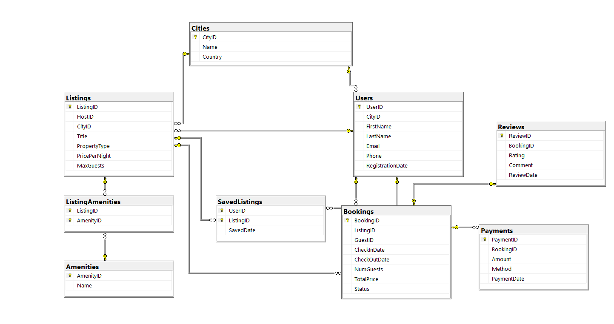
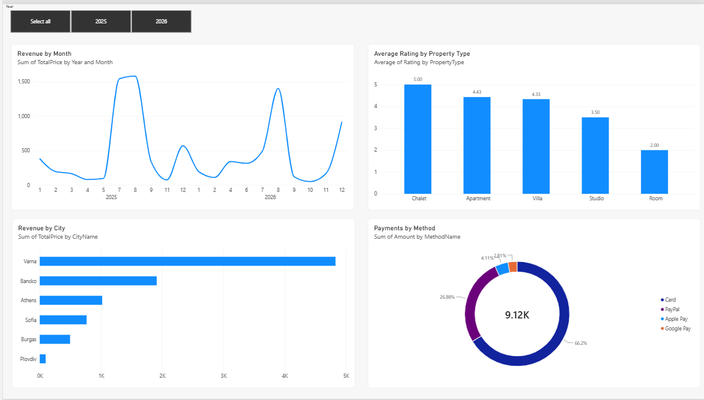

# Airbnb – курсова работа

- **Студент:** Ива Славчева
- **Факултетен номер:** 2401321046
- **Проект:** Airbnb – платформа за краткосрочно отдаване на имоти под наем

## Описание

Проектът моделира основните процеси в Airbnb. Домакините публикуват обяви с удобства. Гостите правят резервации, плащат и пишат отзиви.

- **Концептуален модел** (Chen) и **логически модел** (Crow's Foot): 9 таблици, 42 атрибута и две връзки много към много: *Обява ↔ Удобство* (`ListingAmenities`) и *Потребител ↔ Обява* – любими (`SavedListings`).
- **База данни `AirbnbDB`** (MS SQL Server): функция `fn_CalculateTotalPrice`, процедура `sp_CreateBooking`, тригер `trg_Bookings_NoOverlap` и тестови данни (28 резервации).
- **Data Warehouse `AirbnbDW`** (UML диаграма):
  - 3 таблици факти: `FactBookings`, `FactPayments`, `FactReviews`
  - 6 измерения: `DimDate`, `DimCity`, `DimListing`, `DimGuest`, `DimHost`, `DimPaymentMethod`
- **Power BI отчет:** 4 визуализации – приходи по месеци, приходи по град, средна оценка по тип имот, плащания по метод – и филтър (slicer) по година.

## Структура

```
database/        01_create_database.sql, 02_function_procedure_trigger.sql, 03_insert_data.sql, 04_tests.sql
datawarehouse/   01_create_dw.sql, 02_load_dw.sql, 03_check_dw.sql
diagrams/        Chen, Crow's Foot и UML диаграми (.drawio + .png)
powerbi/         Airbnb_Report.pbix, POWERBI_GUIDE.md
screenshots/     тестове на процедурата и тригера, зареден DW, диаграма на базата, Power BI отчет
```

## Инсталация и стартиране

1. Инсталирай MS SQL Server (Express е достатъчен) и SQL Server Management Studio.
2. В SSMS отвори и изпълни (F5) скриптовете в този ред:
   1. `database/01_create_database.sql`
   2. `database/02_function_procedure_trigger.sql`
   3. `database/03_insert_data.sql`
   4. `datawarehouse/01_create_dw.sql`
   5. `datawarehouse/02_load_dw.sql`
3. За проверка (по желание):
   - `database/04_tests.sql` – тест на функцията, процедурата и тригера
   - `datawarehouse/03_check_dw.sql` – брой редове в таблиците на DW
4. Отвори `powerbi/Airbnb_Report.pbix` в Power BI Desktop. Ако се появи запитване, свържи се със `localhost` / `AirbnbDW`.
5. Диаграмите се отварят на [app.diagrams.net](https://app.diagrams.net).

## Снимки

| | |
|---|---|
| Тест на процедурата и тригера |  |
| Резултат от теста |  |
| Зареден Data Warehouse |  |
| Диаграма на базата в SSMS |  |
| Power BI отчет |  |
